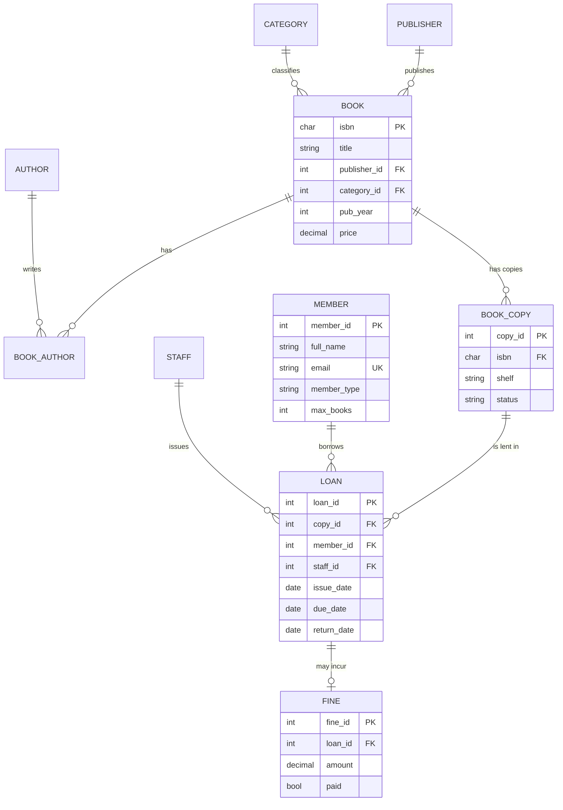

# Project 1: Library Management System

A database for a university library. It tracks books, authors, publishers, physical copies, members, staff, loans and late fines. A console app (`library.py`) runs on top of it.

**Tech:** SQLite 3 + Python 3 (standard library only, nothing to install)

📄 **Case study report:** [docs/Case_Study_Library_Management_System_24BCE2968.pdf](docs/Case_Study_Library_Management_System_24BCE2968.pdf) (Abhinav Yadav, 24BCE2968)

## How to run

**Web portal (Athenaeum):** double-click `run_portal.bat`, or run `python portal.py` and open http://localhost:8100. It has four screens: Overview, Catalogue (live search), Circulation Desk (issue/return) and Members (history and fines). It is built as a JSON API with a single-page front end.

**Console app:**

```bash
python library.py --reset     # build the database and load sample data (or double-click run_library.bat)
python library.py             # interactive menu
python library.py --report    # print the output of all report queries
```

You can also open `library.db` in **DB Browser for SQLite** or the SQLite extension for VS Code and run the files in `sql/` by hand.

## 1. Problem statement

The library needs to:
- keep a catalogue of books, each with one or more authors, one publisher and one category
- hold several physical copies of each book
- register members (students, faculty, public), each with their own borrowing limit
- record which staff member issued each loan, plus the due date and return date
- charge a late fine of Rs 10 per day and block borrowing until it is paid

## 2. ER diagram



**Cardinalities**
- BOOK–AUTHOR is **M:N**, resolved by the `BOOK_AUTHOR` table
- BOOK–BOOK_COPY is **1:N**: a copy cannot exist without its book (existence dependency)
- LOAN–FINE is **1:0..1**: enforced by `UNIQUE(loan_id)` in `fine`

## 3. Relational schema

| Table | Primary key | Foreign keys |
|---|---|---|
| publisher(publisher_id, name, city, phone) | publisher_id | – |
| category(category_id, name) | category_id | – |
| author(author_id, first_name, last_name, nationality) | author_id | – |
| book(isbn, title, publisher_id, category_id, pub_year, price) | isbn | publisher, category |
| book_author(isbn, author_id, author_order) | (isbn, author_id) | book, author |
| book_copy(copy_id, isbn, shelf, status) | copy_id | book |
| member(member_id, full_name, email, phone, member_type, join_date, max_books) | member_id | – |
| staff(staff_id, full_name, role) | staff_id | – |
| loan(loan_id, copy_id, member_id, staff_id, issue_date, due_date, return_date) | loan_id | book_copy, member, staff |
| fine(fine_id, loan_id, amount, paid) | fine_id | loan |

## 4. Normalization

Start from one unnormalized "library register" relation:

`R(isbn, title, authors, publisher_name, publisher_city, category, copy_id, shelf, member_id, member_name, email, issue_date, due_date, return_date, fine)`

- **1NF:** `authors` is multi-valued. Split it into one row per author, giving a separate `book_author` table, so every attribute is atomic.
- **2NF:** with key `(isbn, author_id)`, `title` depends only on `isbn`. That partial dependency is removed by putting book details in `book` and keeping only the link in `book_author`.
- **3NF:** `isbn → publisher_name → publisher_city` is a transitive dependency, so `publisher` gets its own table. The same applies to `category`. Member details depend on `member_id`, not on the loan, so `member` is a separate table.
- **BCNF:** in every final table, each determinant is a candidate key. For example, in `member` the dependencies are `member_id → *` and `email → *`, and both are keys.

Functional dependencies in the final schema:
- `isbn → title, publisher_id, category_id, pub_year, price`
- `copy_id → isbn, shelf, status`
- `loan_id → copy_id, member_id, staff_id, issue_date, due_date, return_date`
- `loan_id → fine_id, amount, paid` (via `fine.loan_id UNIQUE`)

## 5. Integrity constraints used

| Type | Example |
|---|---|
| Domain / CHECK | `price >= 0`, `status IN (...)`, `due_date > issue_date` |
| Entity | every table has a PRIMARY KEY |
| Referential | FOREIGN KEY with `ON DELETE CASCADE / RESTRICT` |
| Key | `UNIQUE(email)`, `UNIQUE(loan_id)` in `fine` |
| Business rules (triggers) | see below |

## 6. Triggers (in `sql/01_schema.sql`)

| Trigger | Rule |
|---|---|
| `trg_loan_check_copy` | a copy can be issued only if it is `AVAILABLE` |
| `trg_loan_check_limit` | a member cannot go over `max_books` |
| `trg_loan_check_fines` | a member with unpaid fines cannot borrow |
| `trg_loan_issue` | issuing a book sets the copy to `ON_LOAN` |
| `trg_loan_return` | returning a book frees the copy and adds a Rs 10/day fine if it is late |

## 7. Views

- `v_book_availability`: total and available copies per title
- `v_overdue_loans`: open loans past their due date
- `v_member_summary`: loans, active loans and unpaid fines per member

## 8. Queries (`sql/03_queries.sql`)

22 queries covering selection, projection, inner, outer and self joins, GROUP BY and HAVING, nested and correlated sub-queries, `UNION` and `INTERSECT`, `NOT EXISTS`, views, `CASE`, `LIMIT`, and a transaction.

## 9. Files

```
01-library-management-system/
├── README.md            <- this report
├── library.py           <- console application
├── library.db           <- created on first run
└── sql/
    ├── 01_schema.sql    <- DDL: tables, constraints, indexes, triggers, views
    ├── 02_seed.sql      <- sample data
    └── 03_queries.sql   <- report queries
```

> **Using MySQL or Oracle instead?** Change `INTEGER PRIMARY KEY AUTOINCREMENT` to `INT AUTO_INCREMENT PRIMARY KEY` (MySQL) or `NUMBER GENERATED ALWAYS AS IDENTITY` (Oracle). Change `JULIANDAY(a)-JULIANDAY(b)` to `DATEDIFF(a,b)` (MySQL) or `a-b` (Oracle). Rewrite `RAISE(ABORT, ...)` as `SIGNAL SQLSTATE '45000'` (MySQL) or `RAISE_APPLICATION_ERROR` (Oracle).

## 10. Advanced features (see the portal's **Insights** screen)

| Feature | Where | DBMS concept |
|---|---|---|
| Popularity table | `book_stats` + 3 triggers | **Incrementally maintained materialised view**; consistency proven with `EXCEPT` (Q18) |
| "Readers also borrowed" | Q19 / `/api/insights` | Self-join co-occurrence **recommender** |
| Time machine | Q20 / `/api/insights?date=` | **Temporal (valid-time) point-in-time query** |
| Fast limit check | `idx_loan_open_by_member` | **Partial index** (`WHERE return_date IS NULL`) |
| Case-insensitive title lookup | `idx_book_title_lower` | **Expression index** on `LOWER(title)` |
| Q21–Q22 | `EXPLAIN QUERY PLAN` | Query optimisation: proves both indexes are used |
